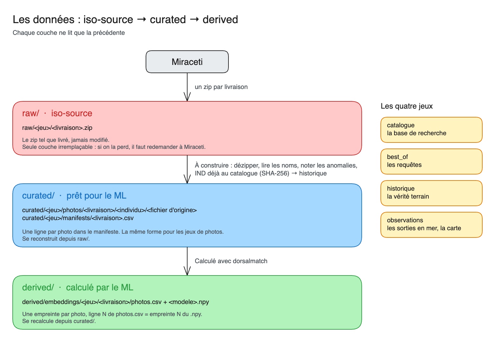

# Cétolog

**Automatiser la reconnaissance des grands dauphins, et valoriser les données d'observation de cétacés.**

Projet Data For Good (saison 15), porté par l'association **Miraceti**.

## Le projet

Miraceti est une association dédiée à l'étude et à la préservation des cétacés en Méditerranée. Son activité repose sur l'observation et le recensement des cétacés, pour appuyer des projets de recherche et des mesures de conservation, avec d'autres institutions (Office Français de la Biodiversité, Aires Marines Protégées).

Ses données d'observation (images, coordonnées GPS, reconnaissance d'individus) sont indispensables pour maximiser son impact. Miraceti fait appel à Data For Good pour améliorer leur gestion interne, et leur valorisation publique.

Miraceti reconnaît chaque grand dauphin à sa **nageoire dorsale** : les encoches et les cicatrices sont comme une empreinte digitale.

Cf. ce qu'a fait l'équipe produit sur Figma : [le matching, étape par étape](https://www.figma.com/board/4hqR7D4iy9CtDQxTRvLoYH/DFG-C%C3%A9tolog-ExMap-Matching-27.10.2026).

## Les deux objectifs

| | 1. L'outil de matching | 2. La carte interactive |
|---|---|---|
| **Aujourd'hui** | Après chaque sortie en mer, Miraceti compare à la main les photos au catalogue, pour savoir si chaque dauphin est déjà connu ou nouveau. **De 45 à 90 minutes par individu**, et des centaines de photos en attente | Les cartes et les données d'observation sont partagées à la main, une par une, pour un territoire, une espèce ou un acteur |
| **Le besoin** | Un matching plus rapide, **sans compromettre la qualité de l'identification** | Des cartes et des données accessibles en autonomie, **sans compromettre leur confidentialité** |
| **Ce qu'on construit** | Récupérer les photos d'une observation, les comparer au catalogue avec un algorithme de computer vision, ajouter les observations au suivi des dauphins | Un portail en ligne qui affiche les données d'observation (type QGIS), avec filtres et export |
| **Pour qui** | Outil interne à Miraceti | Outil public |

**Le principe de l'outil de matching : le ML propose, Miraceti décide.**

## Les données

Les photos de Miraceti sont dans un bucket S3 **privé**. Elles passent par trois couches : les zips tels que livrés (`raw/`), les photos prêtes et décrites (`curated/`), puis ce que calcule le ML (`derived/`).



Le schéma se modifie dans [miraceti_data_couches.excalidraw](docs/assets/miraceti_data_couches.excalidraw), à ouvrir sur [le tableau Excalidraw de Data For Good](https://tableau.services.dataforgood.fr/).

| Jeu | Ce que c'est | Photos | Dauphins |
|---|---|---|---|
| `catalogue` | Une photo par côté pour chaque dauphin connu : la base de recherche | 2 457 | 1 531 |
| `best_of` | Les photos d'une sortie en mer, par individu provisoire : ce qu'il faut identifier | 134 | 24 |
| `historique` | Des dauphins déjà identifiés, sur plusieurs années : pour mesurer le ML | 470 | 61 |
| `observations` | Les observations de cétacés de 2013 à 2026, en shapefile : pour la carte | 1 083 observations | |

Le détail de chaque jeu, ses pièges et ses anomalies : [les données de Miraceti](docs/miraceti_data/README.md).

## Par où commencer

**1. Comprendre le métier.** Le Figma de l'équipe produit (lien ci-dessus), puis [les données de Miraceti](docs/miraceti_data/README.md).

**2. Demander les accès.** Le bucket est privé : demande les credentials à **`mandresyandri`**. Puis suis [l'accès aux données](docs/miraceti_data/acces.md) pour créer ton `.env` et vérifier la connexion.

**3. Choisir ta partie**, selon ton profil :

| Ton profil | Ta partie | Ta doc |
|---|---|---|
| Data engineer | La chaîne de données : des zips aux données prêtes, à construire | [docs/cetolog_pipeline](docs/cetolog_pipeline/README.md) |
| Data scientist, ML engineer | Le ML : empreintes, recherche, d'autres modèles à tester | [docs/cetolog_ml](docs/cetolog_ml/README.md) |
| Analytics engineer, géodonnées | La base de données, QGIS et la carte interactive | [vers une base de données](docs/cetolog_pipeline/bdd.md) |
| Dev backend, dev frontend | L'outil de validation, qui part de la démo | [docs/cetolog_demo](docs/cetolog_demo/README.md) |
| DevOps | La mise en ligne sur Clever Cloud | [mettre la démo en ligne](docs/cetolog_demo/README.md#la-mettre-en-ligne-sur-clever-cloud) |

**4. Prendre une tâche** : chaque doc a sa partie « Où on en est », avec ce qui reste à faire.

## Le dépôt

| Dossier | Rôle |
|---|---|
| `pipeline/` | L'accès au bucket (`storage.py`) ; la chaîne de données est à construire |
| `dorsalmatch/` | La chaîne ML : modèles, empreintes, recherche, mesure |
| `demo/` | La démo Gradio : le ML propose, Miraceti décide |
| `notebooks/` | `data_livraison` : récupérer les données et voir ce qu'on attend ; `baseline_ml` : le niveau à battre |
| `docs/` | La documentation, un dossier par partie |
| `tests/` | Les tests, sans données ni bucket |
| `data/` | La copie locale du bucket, jamais dans Git |

## Installer

Il faut [uv](https://docs.astral.sh/uv/). Depuis la racine du dépôt :

```bash
uv sync --all-groups
```

```bash
cp .env.example .env
```

Remplis `.env` avec les accès reçus, puis vérifie la connexion :

```bash
uv run python -m pipeline.storage check
```

## Tester et commiter

```bash
uv run pytest -q
```

Active une fois les contrôles lancés à chaque commit (`ruff`, et refus des `.env`, des clés, des données et des fichiers de plus de 5 Mo) :

```bash
uvx pre-commit install
```

```bash
uvx pre-commit run --all-files
```

## Les règles

> **NE JAMAIS supprimer `raw/` dans le bucket.** Ce sont les zips tels que livrés par Miraceti : la seule couche irremplaçable. Si on la perd, il faut tout redemander à Miraceti. `curated/` et `derived/` se reconstruisent à partir de `raw/`, l'inverse est impossible.

- **Jamais** de `.env`, de clés ou de données dans Git : le dépôt est public.
- **Pas de photos de Miraceti publiées** sans leur accord.
- **Pas de noms de personnes** (observateurs, photographes) dans le dépôt.
- **Un code simple**, commenté en français, un fichier par rôle.
- **En local d'abord**, puis on publie quand c'est validé.
