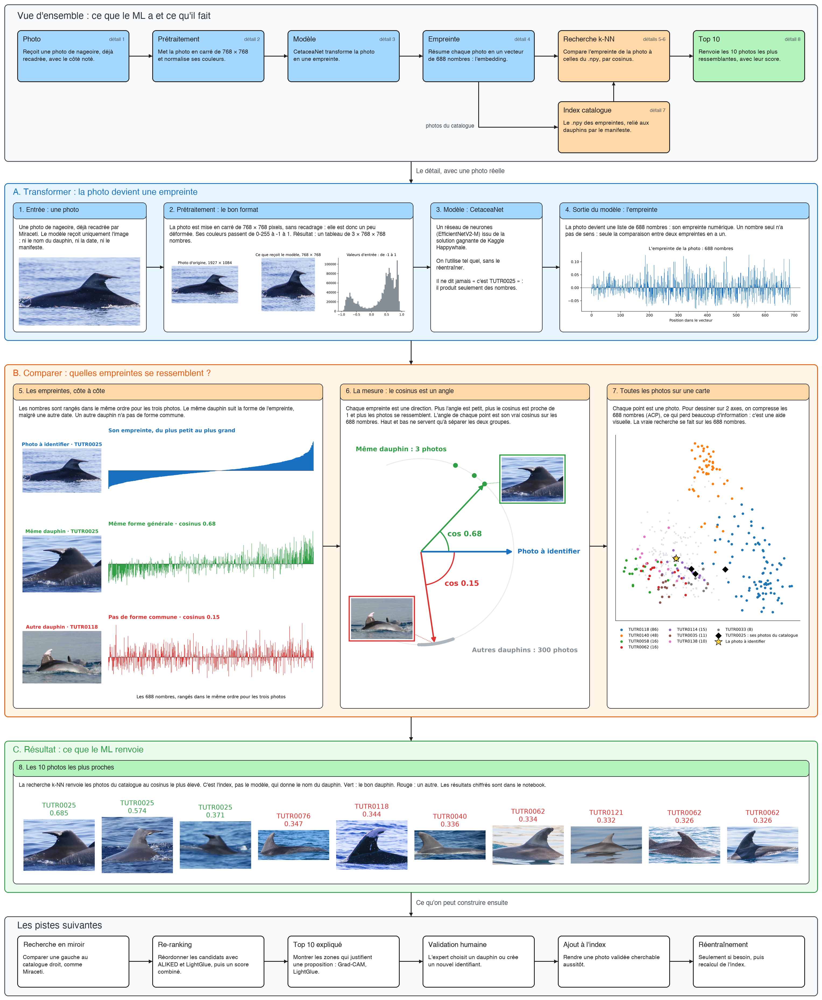

# Le ML de Cétolog

`dorsalmatch` est la partie ML de Cétolog. À partir d'une photo de nageoire dorsale, elle propose les dauphins les plus ressemblants du catalogue.

Le modèle ne reconnaît pas un dauphin : il transforme une photo en empreinte numérique, et on compare ensuite les empreintes entre elles.

Le schéma se modifie avec [dorsalmatch.excalidraw](../assets/dorsalmatch.excalidraw), à ouvrir sur [le tableau Excalidraw de Data For Good](https://tableau.services.dataforgood.fr/).

1. **[Comment ça marche](fonctionnement.md)** : chaque étape du schéma, et où elle est dans le code.
2. **[L'utiliser](utiliser.md)** : calculer des empreintes, chercher, mesurer.
3. **[Le faire évoluer](a_tester.md)** : les modèles et les étapes à tester.

Les résultats chiffrés sont dans [le notebook](../../notebooks/metriques_catalogue.ipynb). Ses exemples en photos n'apparaissent qu'une fois relancé en local.

## Les notions à retenir

**Empreinte :** c'est l'embedding, un vecteur de 688 nombres. Un nombre seul n'a pas de sens, seule la comparaison entre deux empreintes en a un.

**Cosinus :** il mesure l'angle entre deux empreintes. Plus il est proche de 1, plus les photos se ressemblent pour le modèle.

**Fichier `.npy` :** il contient les empreintes, avec une ligne par photo, et aucun nom de dauphin.

**Index :** c'est le fichier `.npy` relié à son `photos.csv`. C'est lui qui donne le nom du dauphin, pas le modèle.
