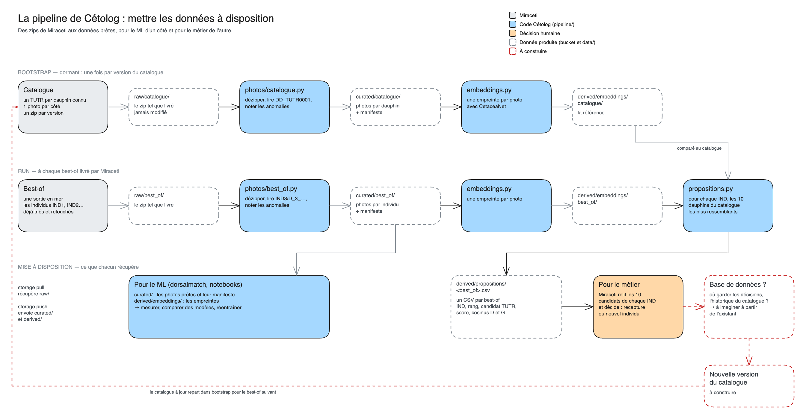

# La pipeline de Cétolog

Ce qui transforme les zips de Miraceti en propositions : pour chaque individu d'un best-of, les 10 dauphins du catalogue qui lui ressemblent le plus. Miraceti n'a plus qu'à choisir.

1. **[Lancer la pipeline](lancer.md)** : les deux commandes, `bootstrap` pour le catalogue et `run` pour chaque best-of, et quand lancer chacune.
2. **[Comment elle marche](fonctionnement.md)** : ce que fait chaque fichier, ce qu'il lit et ce qu'il écrit, comment les propositions sont calculées, et le format du résultat.
3. **[Vers une base de données](bdd.md)** : les données qu'on a déjà, QGIS compris, à mettre dans une base, puis à valoriser dans une couche gold.

Les données elles-mêmes (les jeux, leurs couches, leurs pièges) sont décrites dans [les données de Miraceti](../miraceti_data/README.md).

## En un coup d'œil

Le schéma se modifie dans [cetolog_pipeline.excalidraw](../assets/cetolog_pipeline.excalidraw), à ouvrir sur [le tableau Excalidraw de Data For Good](https://tableau.services.dataforgood.fr/).

**Deux publics, deux sorties :**
- **le ML** récupère `curated/` (les photos prêtes) et `derived/embeddings/` (les empreintes) pour mesurer et comparer des modèles ;
- **le métier** récupère `derived/propositions/` : pour chaque individu d'un best-of, les 10 candidats que Miraceti relit avant de décider.

Les décisions de Miraceti n'ont pas encore de place chez nous. La base de données reste à imaginer à partir de l'existant : [vers une base de données](bdd.md).

## Où on en est

**Fait :**

- Le catalogue, du zip aux empreintes : `bootstrap`.
- Un best-of, du zip aux propositions : `run`. Sur le best-of de Sète (35 individus), la réponse est connue pour 11 d'entre eux : le bon dauphin est 1ᵉʳ pour 8, et dans les 5 premiers pour les 11. C'est un cas favorable : la photo du catalogue date du même jour que les autres photos de l'individu.

**À faire :**

- Mettre les données qu'on a déjà dans une base : [vers une base de données](bdd.md).

Une tâche de pipeline est une nouvelle étape : un fichier dans `pipeline/` qui lit une couche de `data/` et en écrit une autre, comme [`propositions.py`](../../pipeline/propositions.py). [Comment elle marche](fonctionnement.md#ajouter-une-étape) explique comment la brancher.
