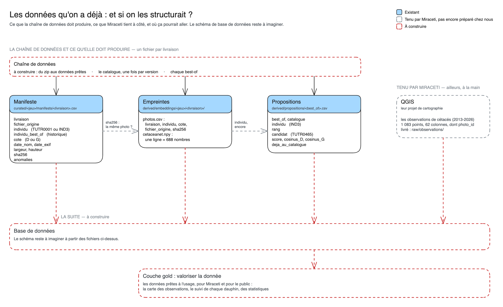

# Vers une base de données

Le schéma se modifie dans [cetolog_donnees.excalidraw](../assets/cetolog_donnees.excalidraw), à ouvrir sur [le tableau Excalidraw de Data For Good](https://tableau.services.dataforgood.fr/).

L'idée : les fichiers de la chaîne de données, ceux de Miraceti et leurs **observations QGIS** (un shapefile de 1 083 observations de 2013 à 2026, décrit dans [le catalogue des données](../miraceti_data/catalogue.md#observations)) vont dans **une base de données**. De là, une **couche gold** valorise la donnée : la carte des observations, le suivi de chaque dauphin, des statistiques.

C'est la suite des couches de `data/` : `raw/` → `curated/` → `derived/` → base → gold.

**Où on en est :** le schéma de la base reste à concevoir, à partir des fichiers ci-dessus.
