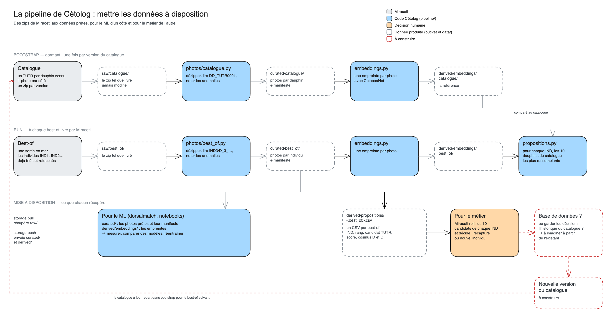

# Comment elle marche

Ce que fait chaque fichier de `pipeline/`, ce qu'il lit, ce qu'il écrit, et comment les propositions sont calculées.

## Le principe : une étape lit une couche, écrit la suivante

Chaque étape lit dans `data/` et écrit dans `data/`, selon les couches décrites dans [le catalogue des données](../miraceti_data/catalogue.md#le-fonctionnement--iso-source--curated--derived) : `raw/` → `curated/` → `derived/`. Aucune étape ne parle à une autre directement. On peut donc relancer, tester ou remplacer une étape sans toucher aux autres.

`bootstrap.py` et `run.py` ne calculent rien eux-mêmes : ils enchaînent les étapes dans l'ordre.

## Les fichiers



Sur le schéma, chaque case bleue est un fichier de `pipeline/`, entre la donnée qu'il lit et celle qu'il écrit (en pointillés). [`bootstrap.py`](../../pipeline/bootstrap.py) enchaîne la première ligne, [`run.py`](../../pipeline/run.py) la seconde. [`storage.py`](../../pipeline/storage.py) fait le lien avec le bucket : `pull` récupère `raw/`, `push` envoie `curated/` et `derived/`.

### Du zip aux photos prêtes : `photos/`

[`photos/manifest.py`](../../pipeline/photos/manifest.py) contient tout ce qui est commun : dézipper, lire la taille et la date EXIF de chaque photo, calculer son `sha256`, repérer les doublons, ranger les photos par individu et écrire le manifeste.

Chaque jeu a ensuite son script, qui dit **seulement comment lire ses noms de fichiers** :

| Script | Le nom lu | L'individu vient de |
|---|---|---|
| `catalogue.py` | `DD_TUTR0001_img_8940.jpg` : côté, identifiant | le nom du fichier |
| `best_of.py` | `IND3/D_3_20230307_Sete_….jpg` : côté, numéro, date | le dossier `IND<n>` |

**Les anomalies sont notées, jamais corrigées** : une photo au nom bizarre garde sa ligne dans le manifeste, avec la colonne `anomalies` remplie. Le détail par jeu est dans [le catalogue des données](../miraceti_data/catalogue.md#les-jeux-de-données).

### Des photos aux empreintes : `embeddings.py`

Pour chaque livraison d'un jeu, une empreinte par photo avec CetaceaNet (via [`dorsalmatch`](../../dorsalmatch/README.md)) :

```text
derived/embeddings/<jeu>/<livraison>/
├── photos.csv        une ligne par photo
└── cetaceanet.npy    une empreinte par ligne de photos.csv : 688 nombres, de norme 1
```

`bootstrap` ne calcule que le catalogue, `run` que les best-of. Le modèle n'est chargé qu'une fois par lancement.

### Des empreintes aux propositions : `propositions.py`

Pour chaque individu provisoire d'un best-of (`IND3`), on classe les dauphins du catalogue en trois temps :

1. **Côté par côté.** Pour chaque dauphin du catalogue, on garde son **meilleur cosinus** avec les photos de l'individu, en ne comparant que les dorsales droites entre elles, et les gauches entre elles.
2. **Les deux côtés ensemble.** Le score d'un dauphin est la **moyenne des côtés** que l'individu et lui ont en commun. Un dauphin vu seulement à droite n'est jugé que sur sa droite.
3. **Les photos identiques sont écartées.** Un cosinus de 0,97 ou plus, c'est la même photo : le catalogue a déjà repris une photo de ce best-of. Elle n'est pas proposée (sinon le ML retrouverait sa propre photo), mais elle donne **la réponse**, notée dans `deja_au_catalogue`.

On garde les 10 meilleurs scores par individu.

## Le résultat : les propositions

`derived/propositions/<best_of>.csv` : une ligne par candidat, 10 par individu, du plus probable au moins probable.

| Colonne | Contenu |
|---|---|
| `best_of` | Le best-of traité |
| `catalogue` | La version du catalogue utilisée |
| `individu` | L'individu provisoire : `IND3` |
| `rang` | 1 pour le plus ressemblant, jusqu'à 10 |
| `candidat` | Le dauphin du catalogue proposé : `TUTR0465` |
| `score` | La moyenne des cosinus des côtés en commun : plus il est proche de 1, plus ça ressemble |
| `cosinus_D`, `cosinus_G` | Le meilleur cosinus de chaque côté, vide si l'un des deux n'a pas ce côté |
| `deja_au_catalogue` | Le ou les `TUTR` qui ont déjà une photo de cet individu : la réponse, si elle est connue |

**Le score n'est pas une probabilité.** Il sert à classer les candidats d'un même individu, pas à dire « c'est lui à 80 % ». Un individu dont le premier candidat a un score faible est peut-être un **nouveau dauphin** : c'est l'étape à faire « repérer les nouveaux individus ».

## Ajouter une étape

Une étape, c'est un fichier dans `pipeline/` qui :

1. **lit une couche de `data/`** et écrit dans une autre, avec un chemin qui dit le jeu et la livraison ;
2. **écrit son résultat en dernier** : un fichier présent veut dire une étape finie, et une étape finie est sautée au prochain lancement ;
3. **a une fonction `run(data)`**, pour que les tests la lancent sur un dossier temporaire, sans bucket ni vraies photos ;
4. **est appelée par `bootstrap.py` ou `run.py`**, selon qu'elle concerne la référence ou chaque best-of.

Puis on ajoute son dossier de `derived/` dans `PUSHED` ([`storage.py`](../../pipeline/storage.py)) pour qu'il parte dans le bucket, et sa case dans [le schéma](../assets/cetolog_pipeline.excalidraw), réexporté en PNG.

[`tests/test_pipeline.py`](../../tests/test_pipeline.py) montre comment tester toute la chaîne avec un faux modèle (la couleur moyenne de la photo), sans PyTorch :

```bash
uv run pytest tests/test_pipeline.py
```
