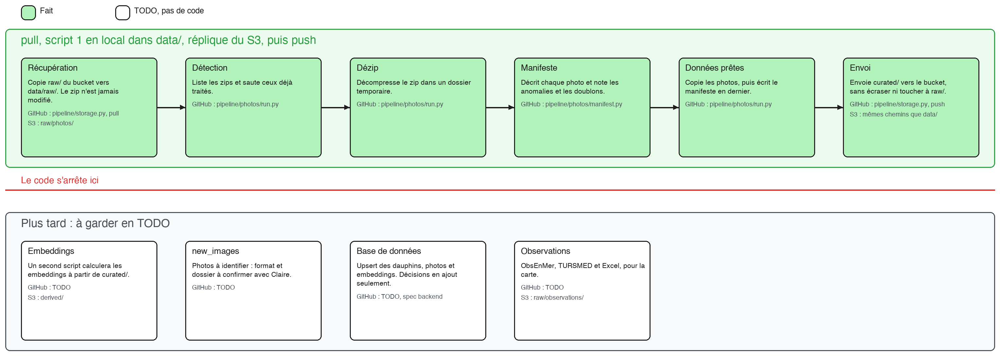

# Pipeline de données

La pipeline récupère les livraisons de photos depuis le bucket S3, les transforme en données prêtes pour le ML, en local, puis les renvoie sur le bucket.

**`data/` est la réplique locale du bucket :** mêmes dossiers, mêmes chemins, jamais commité. On travaille toujours en local d'abord, et on publie seulement quand le résultat est bon.



Le schéma se modifie avec [`assets/data_pipeline.excalidraw`](assets/data_pipeline.excalidraw), à ouvrir sur [le tableau Excalidraw de Data For Good](https://tableau.services.dataforgood.fr/).

## Où on en est

| Partie | État |
|---|---|
| Description des photos : `pipeline/photos/manifest.py` | Fait |
| Dépôt de la première livraison | Fait, dans `raw/photos/` |
| Récupération et envoi : `pull` et `push` de `pipeline/storage.py` | Fait |
| Script 1 : `pipeline/photos/run.py` | Fait, première livraison traitée |
| Le reste de la chaîne | En TODO, pas de code pour l'instant |

## Récupération : du bucket au local

`pull`, dans `pipeline/storage.py`, copie `raw/` du bucket vers `data/raw/`, avec les mêmes chemins, en sautant ce qui est déjà là.

## Script 1 : du zip aux données prêtes

**Entrée :** un zip dans `data/raw/photos/`, avec un dossier par dauphin.

**Sortie :** les photos dans `data/curated/photos/<livraison>/` et leur manifeste dans `data/curated/manifests/<livraison>.csv`.

| Étape | Rôle | Fichier |
|---|---|---|
| Détection | Liste les zips et saute ceux déjà traités | `pipeline/photos/run.py` |
| Dézip | Décompresse le zip dans un dossier temporaire | `pipeline/photos/run.py` |
| Manifeste | Décrit chaque photo et note les anomalies et les doublons | `pipeline/photos/manifest.py` |
| Photos prêtes | Copie les photos dans `data/curated/photos/` | `pipeline/photos/run.py` |
| Manifeste final | Écrit en dernier : il marque la livraison comme traitée | `pipeline/photos/run.py` |

Le manifeste est écrit en dernier pour pouvoir relancer le script après une interruption.

## Envoi : du local au bucket

`push`, dans `pipeline/storage.py`, envoie `data/curated/` vers le bucket, avec les mêmes chemins. Il envoie les photos d'abord et les manifestes en dernier, saute ce qui existe déjà et ne touche jamais à `raw/`.

## Ce que le code ne fait pas pour l'instant

| Sujet | Pourquoi c'est en TODO |
|---|---|
| Embeddings | Ils seront calculés à partir de `curated/`, avec un second script |
| Photos à identifier | Leur format et leur dossier restent à confirmer avec Miraceti |
| Base de données | Elle relève du backend et sera décrite dans sa spec |
| `raw/observations/` | Les observations alimenteront la carte, sans passer par le ML |

## Structure

Le bucket et `data/` ont la même structure :

```text
├── raw/
│   ├── photos/<livraison>_photos.zip
│   └── observations/
└── curated/
    ├── photos/<livraison>/<dauphin>/...
    └── manifests/<livraison>.csv
```

Le détail est dans [le catalogue du bucket](s3_bucket.md).

## Les règles

- `raw/` ne se modifie jamais : une correction est une nouvelle livraison.
- `data/` réplique le bucket : un chemin local est aussi son chemin dans le bucket.
- Tout ce qui est hors de `raw/` peut être reconstruit par le script.
- Le script peut être relancé sans créer de doublon.
- Les données ne vont jamais dans Git : le dépôt est public.

## Lancer

Les commandes sont dans le [README de la pipeline](../pipeline/README.md).
