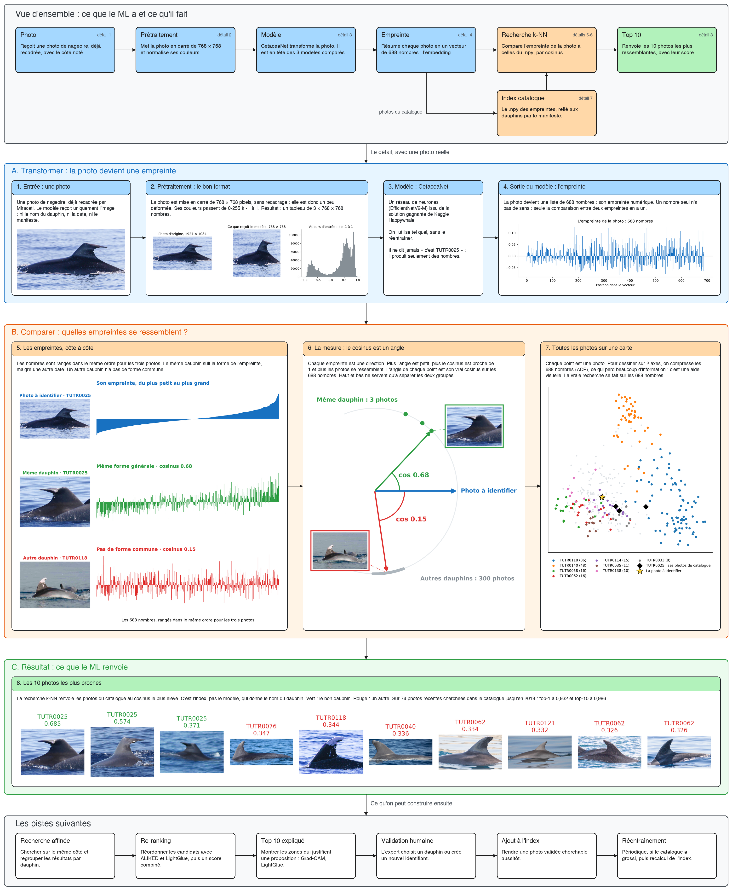

# dorsalmatch

`dorsalmatch` est la partie ML de Cétolog. À partir d'une photo de nageoire dorsale, elle propose les photos les plus ressemblantes du catalogue.

Le modèle ne reconnaît pas un dauphin : il transforme une photo en empreinte numérique, et on compare ensuite les empreintes entre elles.



Le schéma se modifie avec [`assets/dorsalmatch.excalidraw`](assets/dorsalmatch.excalidraw), à ouvrir sur [le tableau Excalidraw de Data For Good](https://tableau.services.dataforgood.fr/).

## La chaîne

| Étape | Entrée | Sortie |
|---|---|---|
| Prétraitement | Une photo recadrée | Un tableau de 3 × 768 × 768 nombres |
| Modèle (CetaceaNet) | Ce tableau | Une empreinte de 688 nombres |
| Index | Les empreintes et le manifeste du catalogue | Le catalogue cherchable |
| Recherche k-NN | Une empreinte et l'index | Les photos les plus proches et leur cosinus |
| Top 10 | Les résultats de la recherche | Les 10 photos à présenter |

## Les notions à retenir

**Empreinte :** c'est l'embedding, un vecteur de 688 nombres. Un nombre seul n'a pas de sens, seule la comparaison entre deux empreintes en a un.

**Cosinus :** il mesure l'angle entre deux empreintes. Plus il est proche de 1, plus les photos se ressemblent pour le modèle.

**Fichier `.npy` :** il contient les empreintes, avec une ligne par photo, et aucun nom de dauphin.

**Index :** c'est le fichier `.npy` relié au manifeste. C'est lui qui donne le nom du dauphin, pas le modèle.

```python
catalogue = np.load("cetaceanet.npy")      # une ligne par photo du catalogue
scores = catalogue @ empreinte_photo       # un cosinus par photo, car les vecteurs sont de norme 1
top_10 = np.argsort(-scores)[:10]          # les lignes les plus proches
```

## Résultats

Test sur la livraison de 377 photos de 50 dauphins : 74 photos à partir de 2020 sont cherchées dans un catalogue de 303 photos, jusqu'en 2019 ou sans date.

| Modèle | Top-1 | Top-10 |
|---|---|---|
| CetaceaNet | 0,932 | 0,986 |

Ces photos sont déjà recadrées, et tous leurs dauphins sont présents dans le catalogue.

## Les pistes suivantes

| Piste | Objectif | Outils |
|---|---|---|
| Recherche affinée | Chercher sur le même côté et regrouper les résultats par dauphin | |
| Re-ranking | Réordonner les candidats | ALIKED, LightGlue |
| Top 10 expliqué | Montrer les zones qui justifient une proposition | Grad-CAM, LightGlue |
| Validation humaine | Choisir un dauphin ou créer un identifiant | |
| Ajout à l'index | Rendre une photo validée cherchable aussitôt | |
| Réentraînement | Adapter le modèle si le catalogue a grossi | |
