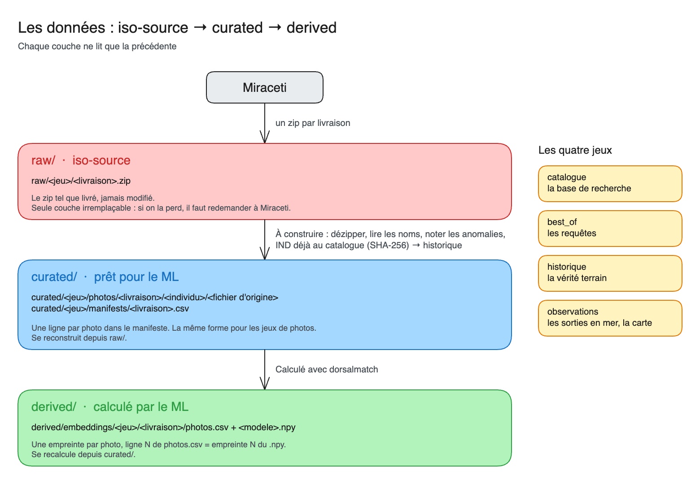

# Le catalogue des données

D'où viennent les données, comment elles sont rangées, et ce que contient chaque jeu. Les chiffres sont ceux du 10 novembre 2026.

## D'où viennent les données

Miraceti identifie chaque grand dauphin à sa **nageoire dorsale** : les encoches et les cicatrices sont comme une empreinte digitale. Après chaque sortie en mer, l'équipe de Miraceti :
1. **trie** les photos et retire l'inexploitable (flou, que de l'eau, trop loin) ;
2. **retouche** les photos gardées dans Lightroom : dorsale au centre, cicatrices mises en valeur ;
3. **regroupe** les photos par individu provisoire (`IND1`, `IND2`…), puis choisit la **meilleure photo** droite et gauche de chacun : le tout forme le **best-of** de l'observation ;
4. **compare** chaque individu au **catalogue**, une photo par côté pour chaque dauphin connu, pour savoir si c'est un dauphin déjà vu (un `TUTR`) ou un nouveau.

Les photos qu'on reçoit sont donc **déjà triées, retouchées et recadrées**. Miraceti les envoie en zip :

| Reçu le | Zip | Ce que c'est | Jeu |
|---|---|---|---|
| 29 octobre 2026 | « Smash » | 50 dauphins déjà identifiés, rassemblés à la main, avec leurs photos de 2005 à 2025 | historique |
| 6 novembre 2026 | « Catalogue Tt » | Le catalogue complet, exporté le 27 janvier 2026 | catalogue |
| 6 novembre 2026 | « Bestof_20230307_Sete » | Le best-of d'une observation à Sète, le 7 mars 2023 | best_of, et historique pour 11 individus déjà au catalogue |
| 10 novembre 2026 | « Shape Obs MIRACETI 2014-2026 » | Les observations de cétacés de 2013 à 2026 (le nom du zip dit 2014), en shapefile (QGIS) | observations |

## Le fonctionnement : iso-source → curated → derived

Les données passent par trois couches, dans le bucket comme dans la copie locale `data/`. Chaque couche ne lit que la précédente.



Le schéma se modifie dans [miraceti_data_couches.excalidraw](../assets/miraceti_data_couches.excalidraw), à ouvrir sur [le tableau Excalidraw de Data For Good](https://tableau.services.dataforgood.fr/).

`curated/` se reconstruit depuis `raw/`, et `derived/` se recalcule depuis `curated/`. Les jeux de photos (`catalogue`, `best_of`, `historique`) ont la même forme à chaque couche ; `observations` n'est encore que dans `raw/`.

| Couche | Contient | Écrit par | Si on la perd |
|---|---|---|---|
| **raw/** (iso-source) | Les zips de Miraceti, tels quels | Dépôt à la main | Il faut redemander à Miraceti |
| **curated/** | Les photos dézippées, rangées par individu, et un manifeste | La chaîne de données, à construire | On la relance depuis `raw/` |
| **derived/** | Les empreintes du ML et les propositions | La chaîne de données, à construire | On relance le calcul |

### Comment chaque couche est produite

Les versions actuelles de `curated/` et `derived/` sont prêtes dans le bucket. La chaîne qui les produit est à construire : voir [le notebook de livraison](../../notebooks/data_livraison.ipynb). Les empreintes actuelles sont calculées avec CetaceaNet.

**Les règles de nommage :**
- **un jeu** est un dossier : `catalogue`, `best_of`, `historique` ou `observations` ;
- **une livraison** porte le nom de son zip : la date de réception, puis ce que c'est (`2026-11-06_catalogue_tt`) ;
- **un individu** est un dossier : un `TUTR` pour le catalogue et l'historique, un `IND` pour le best-of ;
- **une photo** garde son nom d'origine. Il contient parfois le nom du photographe, d'où le bucket privé.

## Les jeux de données

| Jeu | Livraison | Photos | Individus | Droite / gauche | Les deux côtés | Annoté |
|---|---|---|---|---|---|---|
| [catalogue](#catalogue) | `2026-11-06_catalogue_tt` | 2 457 | 1 531 : 1 530 `TUTR`, 1 `TTGC` | 1 205 / 1 251 | 919 | oui |
| [best_of](#best_of) | `2026-11-06_bestof_20230307_sete` | 134 | 24 `IND` | 46 / 88 | 7 | non |
| [historique](#historique) | `2026-10-29_miraceti` | 377 | 50 `TUTR` | 176 / 201 | 42 | oui |
| [historique](#historique) | `2026-11-06_bestof_20230307_sete` | 93 | 11 `TUTR` | 21 / 72 | 6 | oui |

### catalogue

**Pour le ML :** la base de recherche. C'est là que le ML cherche le dauphin.

**Dans le zip :**

```text
Catalogue Tt/
├── DD_20260127/DD_TUTR0001_img_8940.jpg       DD = dorsale droite
└── DG_20260127/DG/DG_TUTR0001_img8962.jpg     DG = dorsale gauche
```

**Lecture :** tout est dans le nom du fichier, pas dans les dossiers. `DD` ou `DG` donne le côté, puis vient l'identifiant, complété à 4 chiffres (`TUTR539` devient `TUTR0539`). Le nom n'a pas de date : seule la date EXIF est lue, et 282 photos n'en ont pas.

**Taille :** 1 531 dauphins ont une photo, `TTGC2050` compris. Les numéros vont jusqu'à `TUTR2039`, avec des trous : un dauphin sans photo dans cet export ne peut pas être proposé par le ML.

**Anomalies**, notées dans le manifeste sans être corrigées :

| Anomalie | Photos | Exemple |
|---|---|---|
| doublon exact | 12 | le même fichier deux fois |
| plusieurs photos pour ce côté | 12 | 6 dauphins, dont `TUTR0558` et `TUTR0297` |
| png | 2 | `DD_TUTR0657_20150807_frioul_pncal.png` |
| identifiant hors `TUTR` | 1 | `DG_TTGC2050_fd-galeria_070501_041.jpg` |
| double extension | 1 | `DG_TUTR0004_sln-35.jpg.jpg` |
| nom illisible (0555 ou 0558 ?) | 1 | `DG_TUTR05558_…`, rangée dans `illisible/` |

**À faire trancher par Miraceti :** les 12 doublons exacts sont 6 fichiers présents sous deux `TUTR` différents (`TUTR0001` et `TUTR1167`, `TUTR1174` et `TUTR1499`, `TUTR0207` et `TUTR1333`, `TUTR0257` et `TUTR1364`). Trois autres paires ont des photos quasi identiques : `TUTR1854` et `TUTR1855`, `TUTR1185` et `TUTR1186`, `TUTR1865` et `TUTR1877`.

### best_of

**Pour le ML :** les requêtes, ce que l'outil recevra. Le `TUTR` de chaque individu n'est pas encore connu.

**Dans le zip :**

```text
Bestof_20230307_Sete/
├── DD/  DG/                                                les meilleures photos de Miraceti : des copies de photos d'IND/
└── IND/IND3/D_3_20230307_Sete_<photographe>_IMG_4508.jpg   toutes les photos gardées de l'individu
```

**Lecture :** le dossier `IND<n>` donne l'individu. Le nom donne le côté, le numéro et la date. Chaque individu a entre 1 et 19 photos. Aucune anomalie.

**Ce qui est utilisé :** toutes les photos de `IND/`, pas seulement les meilleures. Miraceti compare au catalogue une photo par côté (`DD/`, `DG/`) ; la démo cherche chaque individu avec toutes ses photos et garde, pour chaque dauphin du catalogue, le meilleur cosinus. Aucune photo n'est perdue, puisque `DD/` et `DG/` sont des copies. Deux conséquences :
- le manifeste ne dit pas encore quelle photo Miraceti a élue meilleure, alors que c'est elle qui entre au catalogue ;
- plus un individu a de photos, plus le score de son premier candidat a tendance à monter : un score n'a de sens que comparé aux autres candidats du même individu.

**La règle : un individu déjà au catalogue passe en historique.** Miraceti verse au catalogue la meilleure photo d'un best-of déjà matché. Un individu dont une photo a le même SHA-256 qu'une photo du catalogue est donc déjà identifié : ce n'est plus une donnée à identifier, mais une donnée annotée. Il passe dans l'historique, sous la même livraison, renommé avec son `TUTR`. La colonne `individu_best_of` garde son nom d'origine (`IND7`).

Pour Sète, 11 individus sur 35 sont dans ce cas : le best-of en garde 24, l'historique en gagne 11. Ces 11 dauphins sont faciles pour le ML, puisque leurs photos datent du même jour que celle du catalogue. C'est à la chaîne de données d'appliquer cette règle à chaque best-of.

### historique

**Pour le ML :** la vérité terrain. Chaque photo a son `TUTR`, on sait donc si le ML a raison.

**Dans le zip :**

```text
TUTR0033/
├── D_TUTR0033_20171023_sosgb_antibes_dsc05275.jpg
└── G_TUTR0033_20190707_ddv_calanques_dsc_7575.jpg
```

**Lecture :** le dossier `TUTR` donne le dauphin. Le nom donne le côté, l'identifiant et la date, sur 8 ou 6 chiffres.

**Deux livraisons :** `2026-10-29_miraceti` vient du zip « Smash ». `2026-11-06_bestof_20230307_sete` vient du zip du best-of de Sète : ce sont les 11 individus déjà au catalogue (voir [la règle](#best_of)). Elle n'a pas de zip à elle dans `raw/historique/` : elle se reconstruit depuis `raw/best_of/`, en appliquant la règle.

**Anomalies :** la date du nom diffère de la date EXIF (59 photos), le nom n'a pas de date (13), et un nom de fichier ne correspond pas à son dossier (`TUTR0153` dans `TUTR0155`).

**Les pièges :**
- **des photos sont aussi dans le catalogue** : 90 pour `2026-10-29_miraceti` (par exemple `dsc05275` pour `TUTR0033`), 14 pour Sète. On les repère au `sha256`. Pour mesurer le ML, il faut les écarter, sinon il retrouve sa propre photo ;
- deux dauphins concentrent 35 % des photos : `TUTR0118` en a 86 et `TUTR0140` 48.

### observations

**Pour la carte :** les observations de cétacés de Miraceti, de 2013 à 2026. Pas encore traitées : elles servent à la [base de données et à la carte](../cetolog_pipeline/bdd.md).

**Dans le zip :**

```text
Shape Obs MIRACETI 2014-2026/
└── MIRACETI_Obs cetaces_2014-2026.shp   + .dbf, .shx, .prj, .cpg, .qmd : un shapefile QGIS
```

**Lecture :** 1 083 points, un par observation, dont 28 de 2013 malgré le nom du zip, en Lambert 93 (EPSG:2154), encodage UTF-8. Le `.dbf` a 62 colonnes, dont `date`, `heure`, `latitude`, `longitude`, `especes`, `nb_min`, `photo_id` et les activités humaines (`act_peche`, `act_plais`…). Leur sens est à décrire avec Miraceti.

**Le lien avec le ML :** `photo_id` dit si l'observation a donné des photos. C'est la piste pour relier une observation à ses best-of, puis aux dauphins identifiés.

**Confidentialité :** les positions sont précises. Rien de ce jeu ne sort du bucket sans l'accord de Miraceti.

**Où :** `raw/observations/2026-11-10_shape_obs_miraceti_2014-2026.zip`. Rien encore dans `curated/` ni `derived/`.

## Les fichiers de curated/ et derived/

**Le manifeste**, `curated/<jeu>/manifests/<livraison>.csv` : une ligne par photo, les mêmes colonnes pour les trois jeux de photos, plus `individu_best_of` pour l'historique venu d'un best-of.

| Colonne | Contenu |
|---|---|
| `livraison` | Nom de la livraison |
| `fichier_origine` | Nom du fichier livré, inchangé |
| `individu` | `TUTR0000` (catalogue, historique) ou `IND3` (best-of) |
| `individu_best_of` | Historique venu d'un best-of seulement : l'`IND` d'origine |
| `cote` | `D` pour droite, `G` pour gauche |
| `date_nom` | Date lue dans le nom du fichier, vide pour le catalogue |
| `date_exif` | Date de prise de vue lue dans la photo |
| `largeur`, `hauteur` | Taille en pixels |
| `sha256` | Empreinte du fichier : deux photos identiques ont la même |
| `anomalies` | Écarts au format attendu, séparés par ` ; ` |

**Les empreintes**, `derived/embeddings/<jeu>/<livraison>/` :

| Fichier | Contenu |
|---|---|
| `photos.csv` | `livraison`, `individu`, `cote`, `fichier_origine`, `sha256` : une ligne par photo |
| `cetaceanet.npy` | Une empreinte par ligne de `photos.csv`, 688 nombres, de norme 1 (normalisation ImageNet, moyenne de la photo et de son miroir). Recalculées le 10 novembre 2026 |

**Ligne N de `photos.csv` = empreinte N du `.npy`.** Le cosinus entre deux photos est un simple produit scalaire : plus il est proche de 1, plus les dorsales se ressemblent.

**Les propositions**, `derived/propositions/<best_of>.csv` : une ligne par candidat, 10 par individu, du plus probable au moins probable.

| Colonne | Contenu |
|---|---|
| `best_of` | Le best-of traité |
| `catalogue` | La version du catalogue utilisée |
| `individu` | L'individu provisoire : `IND3` |
| `rang` | 1 pour le plus ressemblant, jusqu'à 10 |
| `candidat` | Le dauphin du catalogue proposé : `TUTR0465` |
| `score` | Le meilleur cosinus, tous côtés confondus |
| `cosinus_D`, `cosinus_G` | Le meilleur cosinus avec la photo droite, puis gauche, du candidat ; vide si le candidat n'a pas ce côté |
| `deja_au_catalogue` | Le ou les `TUTR` qui ont déjà une photo de cet individu. Vide depuis que ces individus passent en historique : sinon, un contrôle a raté |

**Le score n'est pas une probabilité.** Il sert à classer les candidats d'un même individu, pas à dire « c'est lui à 80 % ».

## Tenir ce catalogue à jour

Toute nouvelle livraison, ou tout nouveau fichier envoyé dans le bucket, s'ajoute ici : le jeu, la date de réception, ce que c'est, ses chiffres et ses pièges.
